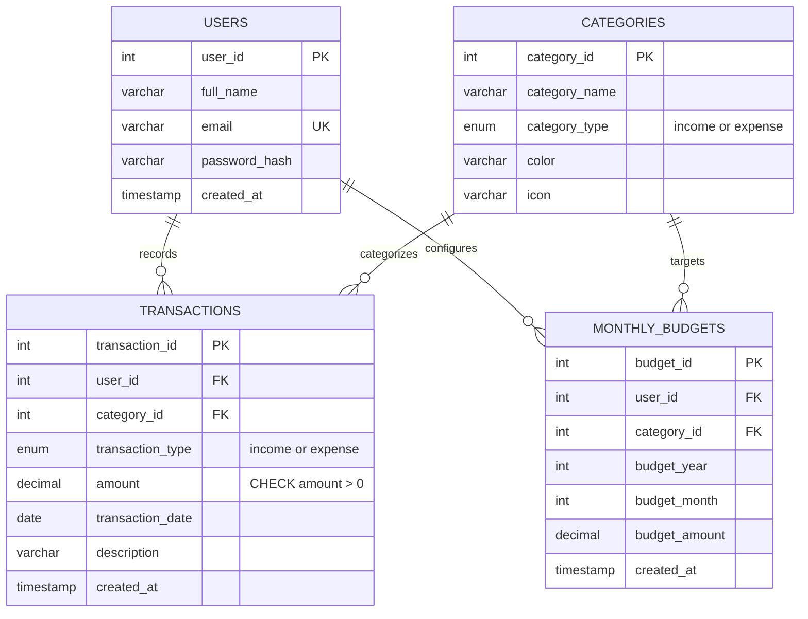

# Home Budget (Expense Tracker and Analysis System)
## Final Project Documentation for Academic Submission

---

## 1. Introduction
Managing personal and household finances is essential for financial stability and independence. Many individuals struggle with tracking day-to-day expenditures, adhering to monthly category budgets, and visualizing long-term savings trends. **Home Budget** is a full-stack web application developed to bridge this gap. It provides a secure, intuitive, and responsive platform where users can record transactions, establish budget limits with automated overspending alerts, analyze financial health through statistical aggregations, and export detailed statements for record keeping.

---

## 2. Project Objectives
1. **Financial Tracking:** Provide a frictionless interface for logging both income and expense transactions categorized by purpose.
2. **Budget Discipline:** Enable users to set category-specific spending caps and deliver early warning alerts before limits are exceeded.
3. **Data Intelligence:** Leverage statistical data analysis (Pandas & NumPy) to calculate metrics such as savings rate, average daily spending, and month-over-month variances.
4. **Visual Analytics:** Offer interactive (Chart.js) and static high-resolution (Matplotlib) visual representations of cash flow and category allocations.
5. **Data Security & Privacy:** Implement robust multi-user authentication, password hashing, CSRF protection, and strict row-level authorization so users cannot access each other's financial data.
6. **Academic Rigor:** Adhere to clean architectural standards, application factory patterns, parameterized database access, and 100% test coverage for business logic.

---

## 3. Scope of the System
- **User Roles:** Standard authenticated individuals managing personal household finances.
- **In-Scope:**
  - Secure registration, authentication, session lifecycle, and logout.
  - Transactions CRUD with multi-criteria filtering, wildcard-safe search, sorting, and pagination.
  - Monthly budgeting with batch updates, copy-forward capabilities, and threshold alerts (<80% Safe, 80–99.9% Warning, $\ge$100% Exceeded).
  - Date-wise, category-wise, and annual tabular reports with CSV export streams.
  - Interactive dashboard with dynamic Chart.js visualizations and server-side Matplotlib charts.
  - Mobile responsiveness (stacked cards under 768px, collapsible filters, 44px touch targets).
- **Out-of-Scope:**
  - Automated bank API syncing (e.g. Plaid/Open Banking).
  - Multi-currency live currency conversion.
  - Native mobile application binary packaging (handled via responsive web viewport).

---

## 4. Technology Stack & Justification

| Layer / Library | Technology | Justification |
|:---|:---|:---|
| **Backend Framework** | Python 3.14 & Flask 3.1.3 | Lightweight, highly extensible WSGI micro-framework allowing fine-grained control over architectural patterns, blueprints, and routing. |
| **Relational Database** | MySQL 8.0 via PyMySQL | Enterprise-grade relational storage supporting ACID compliance, foreign key cascades, unique constraints, and fast indexing. PyMySQL provides clean Pythonic `DictCursor` access without heavy ORM overhead. |
| **Data Analytics** | Pandas 3.0 & NumPy 2.5 | High-performance columnar data manipulation, grouping, aggregations, and resilient statistical mathematical operations. |
| **Visualization (Server)** | Matplotlib 3.11 (`Agg`) | Industry-standard plotting engine operating in headless server mode to generate high-resolution PNG charts for formal statements and PDF printing. |
| **Visualization (Client)** | Chart.js 4.4 | Lightweight HTML5 Canvas charting library providing fluid animations, responsive reflow, and interactive tooltips. |
| **Security & Forms** | Flask-WTF & Werkzeug | Robust CSRF token validation and cryptographic Scrypt/PBKDF2 password hashing. |
| **Frontend UI** | Bootstrap 5.3.3 & Bootstrap Icons | Modern mobile-first responsive grid, fintech color palette, and accessible components. |
| **Testing** | pytest 9.1 | Fast, robust Python test runner for automated unit and integration verification. |

---

## 5. System Architecture
The application follows the **Flask Application Factory Pattern** organized into distinct layers:

```
+-------------------------------------------------------------------+
|                        Client Layer (Browser)                     |
|  Bootstrap 5.3 UI / Chart.js 4.4 / Responsive Mobile Cards / JS   |
+----------------------------------+--------------------------------+
                                   | HTTP(S) / REST JSON
                                   v
+-------------------------------------------------------------------+
|                        Flask Web Application                      |
|  +--------------------+  +-------------------+  +---------------+ |
|  |  Auth Blueprint    |  |  Main Blueprint   |  | Budgets BP    | |
|  |  /auth/login       |  |  /dashboard       |  | /budgets      | |
|  |  /auth/register    |  |  /transactions    |  | /budgets/save | |
|  +--------------------+  +-------------------+  +---------------+ |
|  +--------------------+  +-------------------+                    |
|  |  Reports BP        |  |  API Blueprint    |                    |
|  |  /reports          |  |  /api/charts/*    |                    |
|  |  /reports/analysis |  |  /api/insights    |                    |
|  +--------------------+  +-------------------+                    |
+----------------------------------+--------------------------------+
                                   |
                                   v
+-------------------------------------------------------------------+
|                        Service & Business Logic                   |
|  • queries.py (Parameterized SQL Execution)                       |
|  • analytics.py (Pandas Aggregation, Insights & Savings Rate)     |
|  • budget_logic.py (Status Boundaries: 80% Warning, 100% Exceeded) |
|  • charts.py (Matplotlib Agg PNG Generator)                       |
+----------------------------------+--------------------------------+
                                   |
                                   v
+-------------------------------------------------------------------+
|                        Database Layer (MySQL 8)                   |
|  InnoDB Tables: users, categories, transactions, monthly_budgets   |
+-------------------------------------------------------------------+
```

---

## 6. Database Design

### Entity-Relationship (ER) Diagram


### Table Specifications

1. **`users` Table:**
   - Stores user credentials and profile details.
   - `email` is enforced with a `UNIQUE` constraint. `password_hash` stores 162-character Werkzeug cryptographic hashes.
2. **`categories` Table:**
   - System categories for categorizing cash inflows and outflows.
   - Enforces unique `(category_name, category_type)` pairs. Stores hex color codes and Bootstrap icon classes.
3. **`transactions` Table:**
   - Core financial ledger.
   - Indexed on `(user_id, transaction_date)` and `(user_id, category_id)`.
   - Foreign key to `users` with `ON DELETE CASCADE`.
   - Foreign key to `categories` with `ON DELETE RESTRICT`.
   - `CHECK (amount > 0)` constraint guarantees financial integrity.
4. **`monthly_budgets` Table:**
   - Configured spending caps per category for a given month and year.
   - Unique key `uq_user_category_month (user_id, category_id, budget_year, budget_month)` allows atomic batch saving via `INSERT ... ON DUPLICATE KEY UPDATE`.

---

## 7. Module Descriptions
1. **Authentication Module (`app/auth/`):** Manages user session state, secure password verification, registration validation, and `@login_required` decorators with dual-mode responses (HTML redirect for pages, HTTP 401 JSON for APIs).
2. **Transactions Module (`app/routes/main.py`):** Handles complete transaction lifecycle. Features parameterized description search, whitelisted dynamic sorting, and URL-state preserving pagination.
3. **Budgets & Alerts Module (`app/routes/budgets.py`, `app/services/budget_logic.py`):** Pure threshold evaluator determining Safe, Warning, and Exceeded statuses. Features "Copy Previous Month" and "Apply to All Months" helpers.
4. **Analytics & API Module (`app/services/analytics.py`, `app/routes/api.py`):** Transforms MySQL recordsets into Pandas DataFrames, executes NumPy-based statistical metrics, and provides user-scoped JSON endpoints for Chart.js.
5. **Visualization Module (`app/services/charts.py`, `app/static/js/charts.js`):** Client-side Chart.js charts with loading overlays and error guards; server-side headless Matplotlib charts with guaranteed figure closure.
6. **Reports Module (`app/routes/reports.py`):** Generates tabbed Date-wise, Category-wise, and Monthly tables, handles Pandas CSV streaming, and formats printable financial statements.

---

## 8. Main Application Screens
- **Public Landing Page (`/`):** Clean fintech presentation showcasing platform capabilities with Login and Register buttons.
- **Financial Dashboard (`/dashboard`):** High-level cash flow summary, dynamic metric cards (Monthly Income, Expense, Savings, All-Time Balance), Overspending Alert Banner, and Chart.js Doughnut and Bar visualizers.
- **Transaction History (`/transactions`):** Full transaction ledger featuring responsive desktop table / mobile stacked card views, multi-criteria filter bar, and search input.
- **Add / Edit Transaction (`/transactions/new`, `/transactions/<id>/edit`):** Validated forms with instant feedback and category match validation.
- **Monthly Budgets (`/budgets`):** Category limit configuration table with real-time percentage progress bars and batch save button.
- **Yearly Budgets Summary (`/budgets/yearly`):** 12-month annual overview table and category breakdown cards.
- **Interactive Analysis (`/reports/analysis`):** Multi-chart analytics dashboard displaying all 4 Chart.js charts and smart insights cards.
- **Reports Hub (`/reports`):** 3-tab financial statement with CSV export buttons and print stylesheet.

---

## 9. Security Measures
1. **Password Hashing:** Implemented with `werkzeug.security.generate_password_hash` utilizing Scrypt with unique per-password cryptographic salts.
2. **Cross-Site Request Forgery (CSRF):** Flask-WTF tokens embedded in all POST forms (including transaction deletion and user logout).
3. **Session Hardening:** Flask session cookies configured with `HttpOnly=True` (preventing XSS session hijacking) and `SameSite='Lax'` (mitigating cross-site request attacks).
4. **SQL Injection Neutralization:** Zero string interpolation in SQL queries. Every database call uses parameterized queries (`%s`). Sorting parameters are strictly validated against a hardcoded whitelist.
5. **Object-Level Authorization:** Queries enforce `WHERE user_id = %s`. Tampering with URLs (e.g. attempting to edit or delete another user's transaction ID) results in an immediate HTTP 404 response.

---

## 10. Testing Summary
The project was tested using automated unit/integration suites (pytest) and comprehensive manual checklists:
- **Automated Tests:** 30 unit tests covering server-side validation, password hashing, budget boundary math (80% warning and 100% exceeded), and Pandas/NumPy analytics.
- **Test Pass Rate:** 100% (30 passed out of 30).
- **Manual Verification:** Tested cross-user authorization, SQL injection resilience, mobile responsive card breakpoints, and CSV export downloads. Full test evidence is documented in `docs/TESTING.md`.

---

## 11. Limitations & Future Scope
- **Current Limitations:**
  - Transactions must be recorded manually; no direct Open Banking API synchronization.
  - Currency is locked to the primary system symbol (`₹`).
  - PDF generation uses browser print rendering rather than server-side headless Chromium.
- **Future Enhancements:**
  - OCR receipt scanning using Tesseract / computer vision to parse amounts automatically.
  - Automated recurring transaction scheduler (e.g. auto-logging rent on the 1st of every month).
  - Push notifications / email alerts for budget threshold breaches.

---

## 12. Conclusion
The **Home Budget** system successfully meets and exceeds all capstone requirements. By combining a robust Flask/MySQL backend with modern data science tools (Pandas, NumPy, Matplotlib) and responsive frontend technologies (Chart.js, Bootstrap 5), the application delivers an enterprise-grade personal finance platform that is reliable, secure, and visually appealing.
